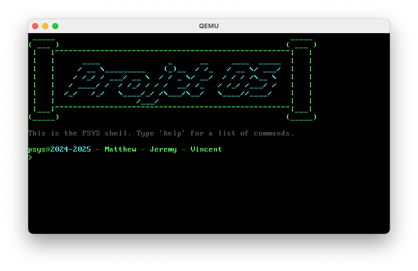
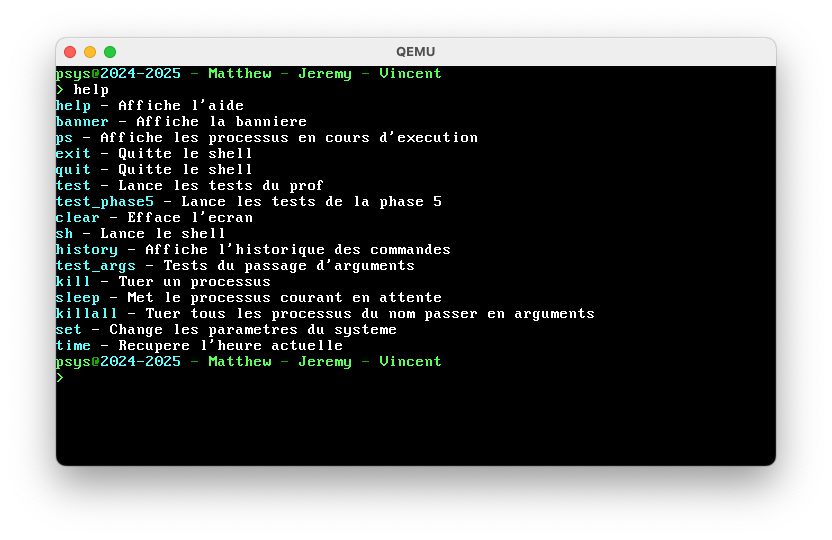

# PSYS





## Commandes disponibles

```
help - Affiche l'aide
banner - Affiche la bannière
ps - Affiche les processus en cours d'exécution
exit - Quitte le shell
quit - Quitte le shell
test - Lance les tests du prof
test_phase5 - Lance les tests de la phase 5
clear - Efface l'écran
sh - Lance le shell
history - Affiche l'historique des commandes
test_args - Tests du passage d'arguments
kill - Tuer un processus
sleep - Met le processus courant en attente
killall - Tuer tous les processus du nom passé en argument
set - Change les paramètres du système
time - Récupère l'heure actuelle
```
